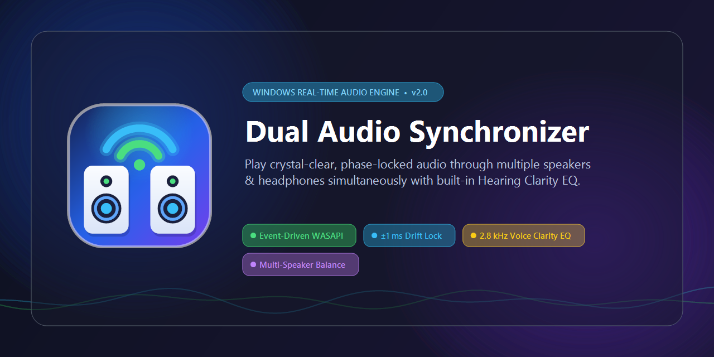
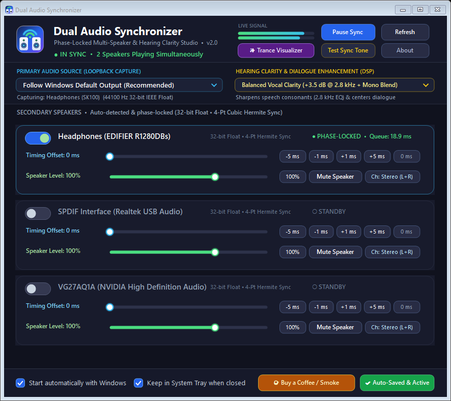
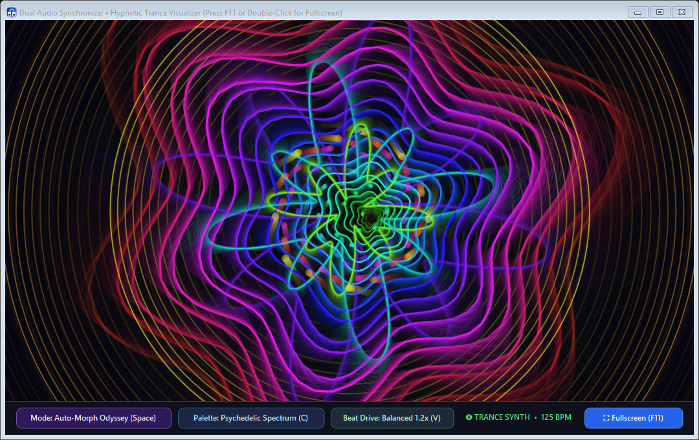

<div align="center">



<br />

# Dual Audio Synchronizer `v2.0`
**Phase-Locked Multi-Speaker Engine & Hearing Clarity Studio for Windows**

[](https://github.com/LIN4CRE/dual-audio-synchronizer/releases/latest)
[](https://lin4cre.github.io/dual-audio-synchronizer/)
[](https://paypal.me/dlinacre16)
[-6366f1?style=for-the-badge&logo=windows)](https://github.com/LIN4CRE/dual-audio-synchronizer)
[](LICENSE)

<p align="center">
  <a href="https://lin4cre.github.io/dual-audio-synchronizer/"><strong>🌐 Live Website</strong></a> •
  <a href="https://github.com/LIN4CRE/dual-audio-synchronizer/releases/latest/download/DualAudioStudio.exe"><strong>⬇️ Direct Download (.exe)</strong></a> •
  <a href="#-instant-1-line-install-or-portable-download"><strong>⚡ 1-Line Install</strong></a> •
  <a href="#-how-it-compares"><strong>📊 Comparison</strong></a> •
  <a href="https://paypal.me/dlinacre16"><strong>☕🚬 Buy Me a Coffee / Smoke</strong></a>
</p>

</div>

---

## 🎯 Why People Use Dual Audio Synchronizer

Windows only lets you play audio through **one** output device at a time—and built-in workarounds like *Windows Stereo Mix* or virtual audio cables suffer from severe Bluetooth clock drift, hollow phasing echoes, and complicated setup.

**Dual Audio Synchronizer** solves this in a single lightweight (`~360 KB`), zero-dependency executable:

* 🎧 **Hard-of-Hearing & Accessibility Listening**: Play TV/movie/PC audio through your desk speakers *and* close-range Bluetooth headphones/neckbands simultaneously, enhanced by a built-in **$2.8\text{ kHz}$ Vocal Clarity Biquad EQ + Center Dialogue Blend** that makes speech consonants crystal-clear.
* ✨ **Fullscreen Hypnotic Trance Visualizer**: Launch the built-in 60 FPS beat-reactive psychedelic visualizer (`✨ Trance Visualizer` button or `F11` for fullscreen)—inspired by **MilkDrop / projectM**, **Sacred Kaleidoscope Mandalas**, and **Shadertoy** warp tunnels—driven by a real-time 512-point Hann-windowed Cooley-Tukey FFT and adaptive spectral-flux beat detector.
* 🎬 **Couples & Friends Sharing 2 Bluetooth Headphones**: Watch movies or listen to music together on two separate pairs of wireless headphones locked in phase within $\pm 1\text{ ms}$.
* 🔊 **True Left / Right Dual-Speaker Stereo Split**: Use the per-speaker **`Ch: Left Only`** and **`Ch: Right Only`** routing button to turn any two independent Bluetooth or wired speakers into a dedicated wide-stage Left/Right stereo pair.
* 🎮 **Gaming Headset + Subwoofer / Desk Monitors**: Feel bass through your room speakers while wearing your primary wireless headset.

<div align="center">
  
  <p><em>Dual Audio Synchronizer v2.0 Studio Control Panel — Phase-locked mirroring between SK100 & EDIFIER R1280DBs with 4-Pt Cubic Hermite Sync, Balanced Vocal Clarity DSP, per-speaker Channel Routing, Trance Visualizer launcher, and 1-click PayPal support button.</em></p>
</div>

---

## ✨ Fullscreen Hypnotic Trance Visualizer (MilkDrop / Sacred Kaleidoscope Inspired)

Click **`✨ Trance Visualizer`** in the studio header (or right-click the System Tray icon) to launch the real-time 60 FPS beat-reactive visualizer—and press **`F11`**, **`F`**, **`Enter`**, or **Double-Click** anywhere to go borderless fullscreen:

<div align="center">
  
  <p><em>60 FPS Hypnotic Trance Visualizer — Driven by a 512-point Radix-2 Cooley-Tukey FFT, 64 logarithmic perceptual frequency bands, adaptive spectral-flux beat detection, and phosphor motion-blur feedback trails.</em></p>
</div>

* **5 Hypnotic Visual Engines (`Space` to cycle)**:
  1. **Auto-Morph Odyssey (MilkDrop Style)**: Blends harmonic warp tunnels, 12-fold sacred kaleidoscope geometry, and stereo Lissajous ribbons while morphing symmetries on every 8th beat.
  2. **Cyber-Vortex Warp Tunnel**: 36 concentric frequency-warped harmonic polygons zooming endlessly toward the viewer with beat-triggered shockwaves.
  3. **Sacred Kaleidoscope Mandala**: 8/12/16-fold dihedral mirror reflections + **137.5° Golden-Angle Phyllotaxis** sacred spiral seeds pulsing to sub-bass and vocal mids.
  4. **Liquid Aurora & 4D Stereo Lissajous Core**: Multi-curtain harmonic aurora waves paired with a true Left/Right stereo phase Lissajous core.
  5. **Wormhole Hyperdrive**: 260 3D perspective star-streaks + 64-band polar logarithmic equalizer + central bass supernova.
* **5 Psychedelic Color Palettes (`C` to cycle)** & **4 Beat Drive Sensitivities (`V` to cycle)**, with an auto-hiding HUD and cursor after 2.8 seconds in fullscreen.

---

## 🚀 Instant 1-Line Install (or Portable Download)

### Option A: 1-Line PowerShell Installer (Creates Desktop & Startup Shortcuts)
Open **PowerShell** and paste this single command:

```powershell
irm https://lin4cre.github.io/dual-audio-synchronizer/install.ps1 | iex
```

### Option B: Direct Portable Executable (Zero Install Needed)
1. Download **[`DualAudioStudio.exe`](https://github.com/LIN4CRE/dual-audio-synchronizer/releases/latest/download/DualAudioStudio.exe)** from the [Latest Release](https://github.com/LIN4CRE/dual-audio-synchronizer/releases/latest).
2. Double-click `DualAudioStudio.exe`. It runs immediately on any Windows 10 or Windows 11 PC with **zero external runtimes or virtual audio drivers required**.

---

## 📊 How It Compares

| Feature | **Dual Audio Synchronizer v2.0** | Windows "Stereo Mix" | Voicemeeter / Virtual Cables |
| :--- | :---: | :---: | :---: |
| **Setup Time** | **Instant (0 config needed)** | Requires hidden driver tweaks | Complex virtual routing & reboot |
| **Active Clock-Drift Correction** | **✅ Yes ($\pm 1\text{ ms}$ continuous phase lock)** | ❌ No (drifts out of sync over time) | ❌ Manual buffer resets required |
| **Built-in $2.8\text{ kHz}$ Speech Clarity DSP** | **✅ Yes (Biquad EQ + Center Blend)** | ❌ No | ⚠️ Manual parametric EQ setup |
| **Per-Speaker Channel Split (`L` / `R` / `Mono`)** | **✅ 1-Click per speaker** | ❌ No | ⚠️ Complex bus routing |
| **Survives Bluetooth Reconnects** | **✅ Automatic GUID + Name matching** | ❌ Drops connection | ❌ Requires manual engine restart |
| **Extra Kernel Drivers Required** | **✅ None (`~360 KB` standalone `.exe`)** | None | Requires virtual audio drivers |

---

## ✨ Key Engineering Highlights

| Capability | Technical Implementation | Benefit |
| :--- | :--- | :--- |
| **Active Clock-Drift Lock** | Continuous exponential moving average (EMA) tracking of WASAPI `GetCurrentPadding()` pinned to a `10.0 ms` target window with $\pm 1\text{ frame}$ linear-interpolated resampling (`ElasticSyncBuffer`). | Eliminates the "phasing / hollow echo" and periodic desynchronization that happens when two Bluetooth speakers run on independent hardware clocks. |
| **1 ms Kernel Timer & Event Loopback** | Calls `winmm.dll` `timeBeginPeriod(1)` on a `ThreadPriority.Highest` real-time worker paired with `AUDCLNT_STREAMFLAGS_EVENTCALLBACK`. | Removes Windows' default `15.6 ms` thread sleep quantum jitter for rock-solid sub-millisecond packet delivery. |
| **Hearing Clarity Studio DSP** | Cascaded 2nd-order Biquad Peaking EQ centered at $2.8\text{ kHz}$ ($Q = 0.95$, $+3.5\text{ dB}$ or $+5.5\text{ dB}$) + Stereo-to-Center Mono Vocal Blend + Soft-Knee $\tanh$ Limiter. | Specifically tuned for hard-of-hearing listeners: sharpens speech consonants (*s, t, k, th*) and anchors vocals across both speakers without digital clipping. |
| **Per-Speaker Channel Routing** | Real-time matrix router supporting `Stereo (L+R)`, `Mono Sum`, `Left Only`, and `Right Only` per secondary speaker. | Lets you combine any two speakers into a dedicated Left/Right stereo pair or full mono/stereo mirror. |
| **Smart Bluetooth GUID Persistence** | Matches audio endpoints by **both** Windows MMDevice GUID and Friendly Name, while automatically filtering out low-bitrate `Hands-Free AG` telephony profiles. | Survives Bluetooth power-cycling and Windows endpoint GUID rotation automatically without losing your speaker configuration. |

---

## 🔧 Signal Flow & Phase-Lock Architecture

```
┌────────────────────────────────────────────────────────────────────────────┐
│                   PRIMARY WINDOWS AUDIO ENDPOINT (WASAPI)                  │
│          e.g., Headphones (SK100) / Default System Playback Device         │
└─────────────────────────────────────┬──────────────────────────────────────┘
                                      │
                   Event-Driven Loopback Capture (32-bit Float)
                   AUDCLNT_STREAMFLAGS_LOOPBACK | EVENTCALLBACK
                                      │
                                      ▼
┌────────────────────────────────────────────────────────────────────────────┐
│                     ELASTIC SYNC RING BUFFER (Per Speaker)                 │
│   • Configurable Delay Calibration Offset (0 ms – 500 ms in 1 ms steps)    │
│   • Real-Time Hardware Padding Telemetry (EMA Queue Target: 10.0 ms)       │
│   • Click-Free Linear-Interpolated ±1 Frame Clock-Drift Rate Controller    │
└─────────────────────────────────────┬──────────────────────────────────────┘
                                      │
                                      ▼
┌────────────────────────────────────────────────────────────────────────────┐
│              CHANNEL ROUTER & HEARING CLARITY DSP PIPELINE                 │
│   1. Channel Matrix: Stereo (L+R) / Mono Sum / Left Only / Right Only      │
│   2. Center Vocal Mono Blend (50% Balanced / 65% Extra Crisp)              │
│   3. 2.8 kHz Biquad Peaking EQ (+3.5 dB / +5.5 dB Consonant Articulation)  │
│   4. Per-Speaker Gain Stage (0% – 150%) + Soft-Knee Tanh Peak Limiter      │
└─────────────────────────────────────┬──────────────────────────────────────┘
                                      │
                                      ▼
┌────────────────────────────────────────────────────────────────────────────┐
│                 SECONDARY HARDWARE RENDER ENDPOINTS (WASAPI)               │
│          e.g., Headphones (EDIFIER R1280DBs), Studio Monitors, SPDIF       │
└────────────────────────────────────────────────────────────────────────────┘
```

---

## 🛠️ Build from Source

No Visual Studio installation is required. Run [`build.ps1`](build.ps1) to generate all high-DPI vector icons/logos and compile `DualAudioStudio.exe` using the built-in Windows .NET Framework compiler:

```powershell
git clone https://github.com/LIN4CRE/dual-audio-synchronizer.git
cd dual-audio-synchronizer
powershell -ExecutionPolicy Bypass -File .\build.ps1
```

---

## ☕🚬 Support the Developer (Buy Me a Coffee or a Smoke!)

**Dual Audio Synchronizer** is 100% free, open-source, ad-free, and built with care to make multi-speaker audio and hearing clarity effortless on Windows.

If this app saved you from audio headaches or helped you hear movies, music, and dialogue clearly across your speakers, consider buying me a coffee or a smoke via PayPal!

<div align="center">

[](https://paypal.me/dlinacre16)

**👉 [https://paypal.me/dlinacre16](https://paypal.me/dlinacre16)**

</div>

---

## 📄 License

Released under the [MIT License](LICENSE). Crafted by **[LIN4CRE](https://github.com/LIN4CRE)**.
